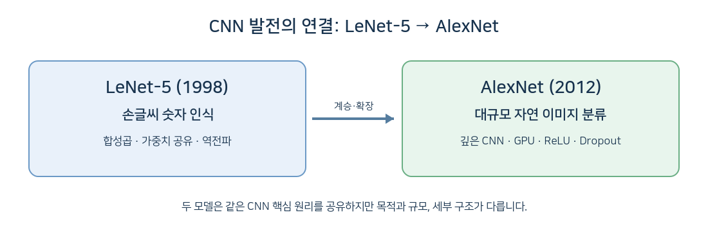
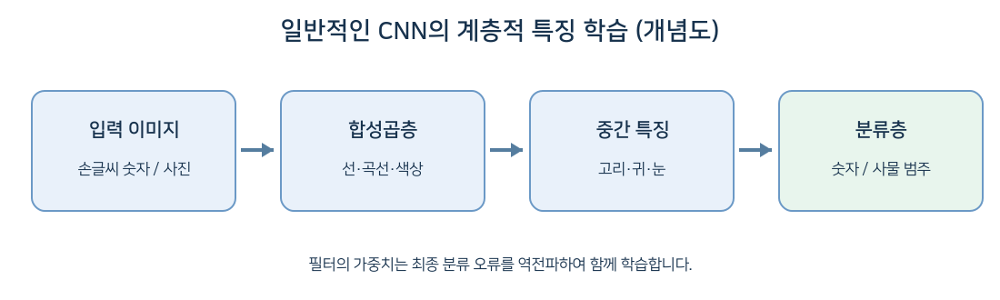
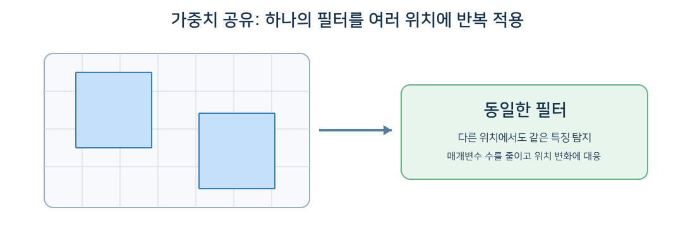
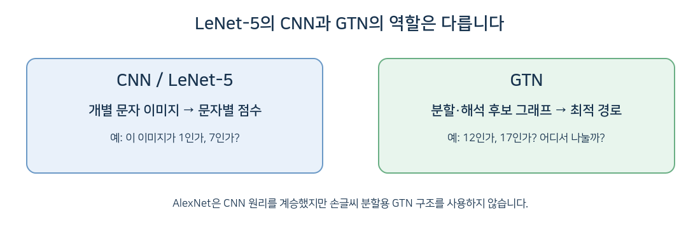

# LeCun(1998)의 CNN 논문이 AlexNet(2012)에 미친 영향

> **강의용 학습자료 | 그림 포함 Markdown 문서**  
> 비교 대상: LeCun et al. (1998), *Gradient-Based Learning Applied to Document Recognition* / Krizhevsky, Sutskever & Hinton (2012), *ImageNet Classification with Deep Convolutional Neural Networks*

## 1. 두 논문의 관계

**LeCun(1998)은 CNN의 주요 구조와 경사 기반 학습을 손글씨·문서 인식에서 체계적으로 설명했고, AlexNet(2012)은 이러한 핵심 원리를 계승해 대규모 자연 이미지 분류에서 높은 성능을 입증했습니다.**

| 구분 | LeCun et al. (1998) | AlexNet (2012) |
|---|---|---|
| 대표 모델 | LeNet-5 | AlexNet |
| 주요 과제 | 손글씨 숫자·문서 인식 | ImageNet 자연 이미지 분류 |
| 대표 데이터 | MNIST(숫자 10종) | ImageNet(1,000종 범주) |
| 구조적 특징 | 합성곱·서브샘플링·완전연결·RBF 출력 | 5개 합성곱층·3개 완전연결층 |
| 학습 방식 | 역전파 기반 경사 학습 | 역전파 및 확률적 경사하강법 |
| 특징적 발전 | CNN 구조의 실용적 정립, 다중 모듈·GTN | GPU, ReLU, Dropout, 대규모 학습 |

**주의:** AlexNet이 LeNet-5의 모든 기술을 그대로 가져왔다는 뜻은 아닙니다. 두 모델은 기본 CNN 원리를 공유하지만, 문제·규모·세부 설계가 다릅니다.

## 2. 핵심 영향 7가지 — 쉬운 예시

### ① 합성곱 필터: 특징을 자동으로 학습

LeNet-5는 손글씨 '8'에서 곡선과 고리 등 분류에 유용한 특징을 필터로 학습합니다. AlexNet은 강아지 사진에서 털의 질감, 귀와 눈의 형태 등 유용한 시각 특징을 학습합니다.

**쉬운 예:** 예전에는 사람이 “강아지는 귀가 있다”처럼 특징을 직접 설계해야 했다면, CNN은 많은 정답 사진을 보면서 분류에 유용한 필터를 학습합니다.

### ② 가중치 공유: 같은 필터를 여러 위치에 사용

LeNet-5와 AlexNet 모두 한 필터의 가중치를 이미지의 여러 위치에 반복 적용합니다.

**쉬운 예:** 사진 왼쪽에 있는 귀와 오른쪽에 있는 귀를 탐지하기 위해 위치마다 완전히 새로운 필터를 만들 필요가 없습니다. 같은 필터를 이동시키며 적용합니다.

### ③ 국소 수용영역: 작은 부분부터 살펴보기

CNN은 처음부터 사진 전체를 하나의 거대한 계산으로 처리하지 않고, 작은 영역에서 시작해 여러 계층에서 특징을 조합합니다.

**쉬운 예:** 처음에는 선과 색 경계를 감지하고, 다음에는 눈·귀와 같은 부분적인 패턴을, 더 깊은 단계에서는 분류에 유용한 복합 특징을 학습할 수 있습니다. 실제 내부 특징이 반드시 사람이 붙인 이름과 일치하는 것은 아닙니다.

### ④ 서브샘플링과 풀링: 중요한 정보를 요약

LeNet-5는 **학습 가능한 계수를 사용하는 평균 기반 서브샘플링**을 사용했습니다. AlexNet은 **Max Pooling**과 겹치는 풀링 영역을 사용했습니다.

**쉬운 예:** 한 영역의 특징 반응이 `0.1, 0.2, 0.9, 0.3`이라면 최대 풀링은 `0.9`를 선택합니다. LeNet-5의 서브샘플링은 이와 동일한 연산이 아니지만, 특징맵의 공간 크기를 줄인다는 목적을 공유합니다.

### ⑤ 역전파: 마지막 오류로 앞쪽 필터까지 학습

LeNet-5는 최종 인식 오류를 이용하여 여러 계층의 매개변수에 대한 기울기를 계산합니다. AlexNet도 이 원리를 사용합니다.

**쉬운 예:** 고양이 사진을 '개'로 잘못 분류했다면 최종 손실을 계산하고, 그 정보가 뒤쪽 분류층부터 앞쪽 합성곱 필터까지 역방향으로 전달됩니다. 그 결과 다음 학습에서 구별에 유용한 특징을 더 잘 포착하도록 가중치가 조정됩니다.

**구분:** 순전파는 `입력 → 특징 추출 → 분류 → 손실`, 역전파는 `손실의 기울기 → 분류층 → 앞쪽 필터`입니다.

### ⑥ 데이터 증강: 변형된 이미지로 일반화 능력 강화

LeNet-5 연구는 손글씨를 변형하여 다양한 필체에 대응하도록 했습니다. AlexNet은 무작위 이미지 자르기, 좌우 반전, RGB 강도 변형 등을 활용했습니다.

**쉬운 예:** 숫자 '7'을 약간 기울여도 '7'로 알아보고, 강아지 사진을 좌우로 뒤집어도 강아지로 분류하도록 학습하는 것입니다.

**주의:** 증강이라는 전략을 공유하지만 두 논문의 구체적인 변형 방법은 다릅니다.

### ⑦ 작은 CNN에서 대규모 CNN으로

LeNet-5는 약 6만 개의 학습 매개변수를 갖는 비교적 작은 CNN입니다. AlexNet은 약 6천만 개의 매개변수를 갖는 훨씬 큰 CNN으로, GPU를 활용해 대규모 이미지에서 학습했습니다.

**쉬운 예:** 손글씨 숫자 10종을 구별하는 문제에서 자동차·개·새 등 1,000종 사물을 구별하는 문제로 확장된 것입니다. 그러나 AlexNet은 단순한 크기 확대를 넘어 새로운 학습 기법을 결합했습니다.

## 3. AlexNet이 특히 발전시킨 기술

| 기술 | 설명 | 쉬운 예 |
|---|---|---|
| **ReLU** | 양수 입력은 유지하고 음수는 0으로 처리하는 활성화 함수 | 깊은 네트워크 학습 속도 개선 |
| **GPU** | 대량의 합성곱 계산을 병렬로 수행 | 방대한 사진을 현실적인 시간 안에 학습 |
| **Dropout** | 학습 중 일부 뉴런의 출력을 무작위로 0으로 만듦 | 특정 특징에 지나치게 의존하는 현상 감소 |
| **Overlapping Max Pooling** | 일부 겹치는 영역에서 최대 특징 반응을 선택 | 특징맵 축소와 특징 선택 |
| **대규모 ImageNet 학습** | 약 120만 장의 학습 이미지와 1,000개 범주 활용 | 손글씨를 넘어 일반 사물 인식 |

AlexNet 논문은 ILSVRC-2010 테스트 데이터에서 **Top-5 오류율 17.0%**를 보고했습니다. 이는 예측 확률 상위 다섯 범주 안에 정답이 없는 비율입니다. 이 수치는 MNIST의 숫자 인식 오류율과 과제가 다르므로 직접 비교하면 안 됩니다.

## 4. CNN과 GTN은 무엇이 다른가?

LeCun(1998) 논문의 제Ⅳ장은 여러 모듈을 연결하는 학습 시스템과 GTN(Graph Transformer Networks)을 설명합니다. **AlexNet이 직접적으로 계승한 핵심은 GTN의 문자 분할 그래프가 아니라 CNN의 합성곱·가중치 공유·역전파 원리입니다.**

| 항목 | CNN / LeNet-5 | GTN 기반 손글씨 인식 시스템 | AlexNet |
|---|---|---|---|
| 주요 입력 | 개별 문자 이미지 | 분할 후보·인식 후보를 담은 그래프 | 자연 이미지 |
| 주요 목표 | 개별 문자 분류 | 문자열 전체의 분할·해석 | 이미지 범주 분류 |
| 핵심 처리 | 합성곱 및 분류 | 그래프 변환 및 경로 비교 | 깊은 합성곱 및 분류 |
| GTN 그래프 처리 | 필수 아님 | 핵심 요소 | 사용하지 않음 |

**예:** 손글씨 '12'를 읽을 때 GTN은 분할 알고리즘이 생성한 후보에 따라 `'1'+'2'`, `'1'+'7'` 등의 해석 경로를 비교할 수 있습니다. 반면 AlexNet은 사진 한 장이 개·고양이·자동차 중 어느 범주인지 분류합니다.

## 5. 핵심 내용 10줄 요약

1. **LeCun(1998)**은 손글씨 인식에서 CNN의 핵심 구조와 경사 기반 학습을 체계적으로 설명했다.
2. **AlexNet(2012)**은 CNN을 대규모 자연 이미지 분류에 성공적으로 적용했다.
3. 두 모델 모두 **합성곱 필터**로 이미지의 유용한 특징을 자동 학습한다.
4. **가중치 공유**로 동일한 필터를 이미지의 여러 위치에 적용한다.
5. **국소 수용영역**을 이용하여 작은 시각 특징부터 복합 특징까지 계층적으로 처리한다.
6. **서브샘플링·풀링**으로 특징맵의 공간 크기를 줄이지만 구체적인 연산은 서로 다르다.
7. **역전파**를 이용해 최종 오류에서 각 계층의 학습 기울기를 계산한다.
8. **데이터 증강**으로 필체나 촬영 조건의 변화에 더 잘 대응하도록 학습한다.
9. AlexNet은 **ReLU·GPU·Dropout** 등을 활용하여 더 크고 깊은 CNN을 학습했다.
10. **LeCun은 CNN의 토대를 정립했고, AlexNet은 대규모 이미지 분류에서 그 잠재력을 보여주었다.**

## 6. 강의용 결론

> **“LeNet-5가 손글씨 숫자를 읽는 CNN의 실용성을 보여주었다면, AlexNet은 그 핵심 원리를 발전시켜 수많은 자연 이미지의 사물을 인식할 수 있음을 보여주었다.”**

LeCun 논문의 GTN은 여러 문자 분할과 인식 후보를 그래프로 처리하기 위한 확장 기술이며, AlexNet의 핵심 이미지 분류 구조와는 구별해야 합니다.

## 참고문헌

1. LeCun, Y., Bottou, L., Bengio, Y., & Haffner, P. (1998). *Gradient-Based Learning Applied to Document Recognition*. Proceedings of the IEEE, 86(11), 2278–2324. https://doi.org/10.1109/5.726791
2. Krizhevsky, A., Sutskever, I., & Hinton, G. E. (2012). *ImageNet Classification with Deep Convolutional Neural Networks*. Advances in Neural Information Processing Systems 25. https://proceedings.neurips.cc/paper_files/paper/2012/file/c399862d3b9d6b76c8436e924a68c45b-Paper.pdf

---

